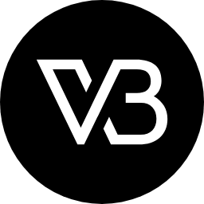
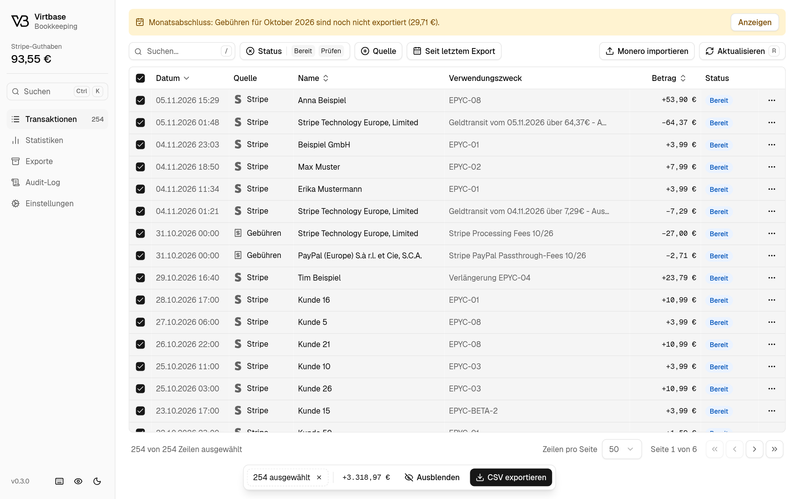
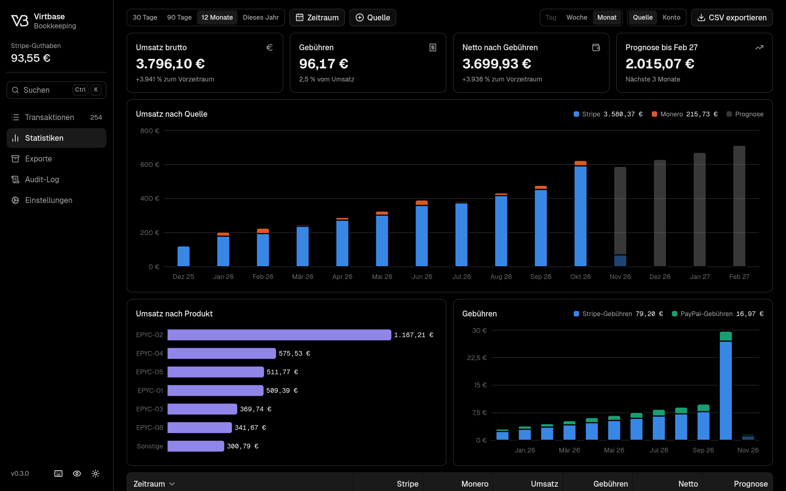
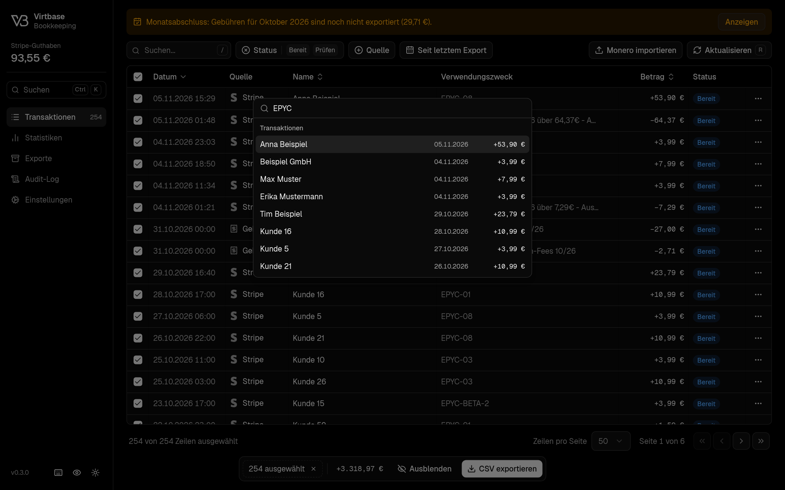
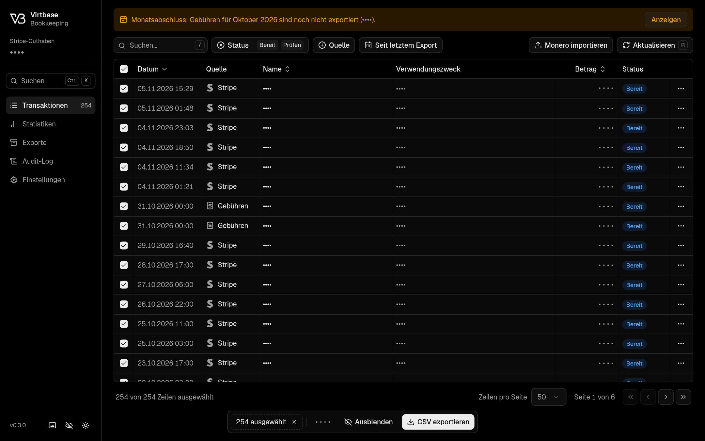
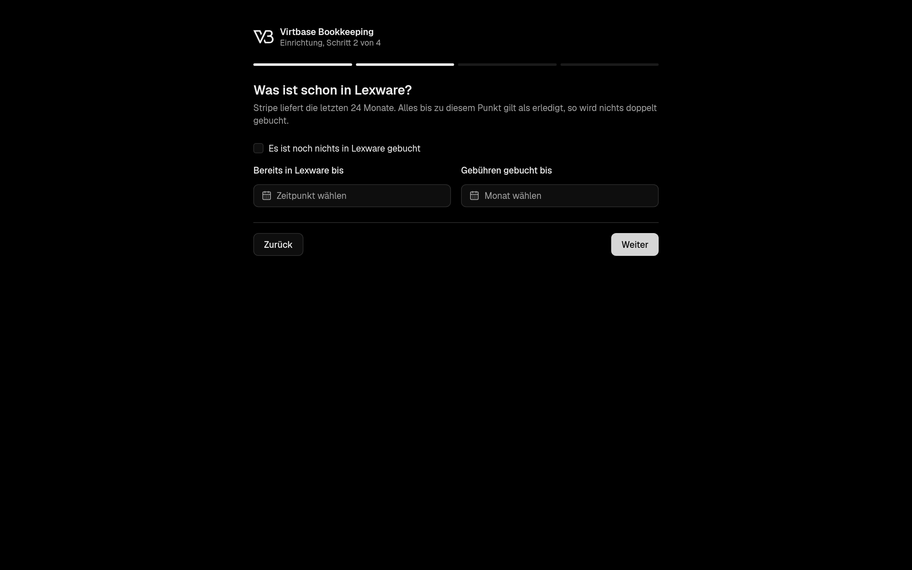
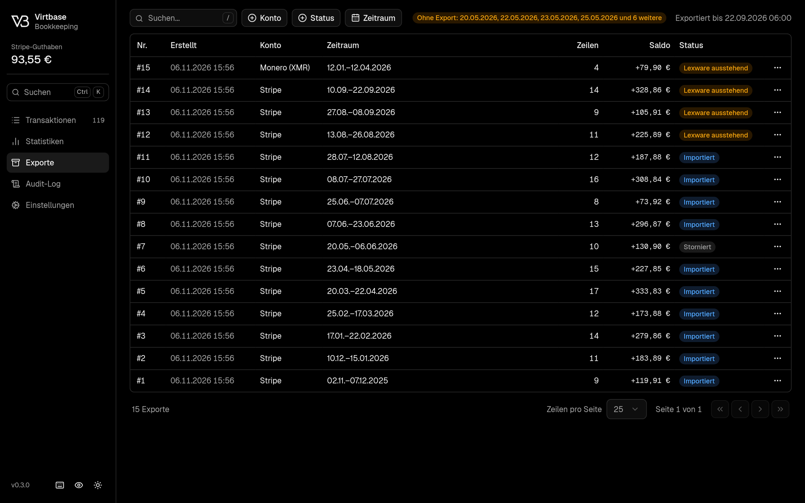
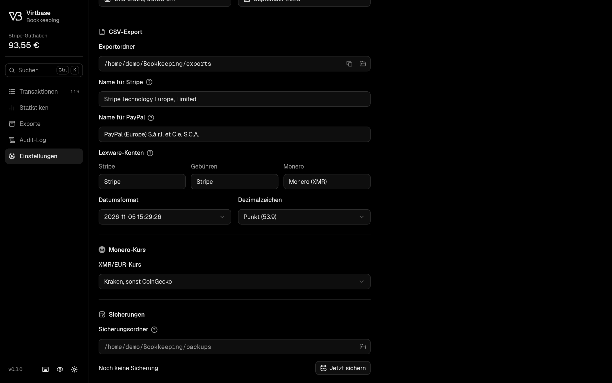

<p align="center">
  
</p>

<h1 align="center">Virtbase Bookkeeping</h1>

<p align="center">
  Turn Stripe and Monero payments into Lexware Office CSV imports, and always know what was already exported.
  <br />
  <br />
  <a href="#quick-start"><strong>Quick start</strong></a> ·
  <a href="#features"><strong>Features</strong></a> ·
  <a href="#screenshots"><strong>Screenshots</strong></a> ·
  <a href="#development"><strong>Development</strong></a>
</p>

<p align="center">
  <a href="https://github.com/virtbase/virtbase-bookkeeping/actions/workflows/ci.yml"></a>
  <a href="LICENSE"></a>
  
  
</p>

<p align="center">
  <picture>
    <source media="(prefers-color-scheme: dark)" srcset=".github/assets/transactions-dark.png">
    <source media="(prefers-color-scheme: light)" srcset=".github/assets/transactions-light.png">
    
  </picture>
</p>

<p align="center"><sub>All screenshots show made-up sample data. The app's interface is in German.</sub></p>

## Features

- **Stripe and Monero in one table.** Stripe syncs through a restricted read-only key, and Monero through a bundled view-only wallet or a CSV import.
- **Lexware Office CSV export.** One file per account, and every exported row is tracked so nothing gets booked twice.
- **Month-end fees.** Stripe and PayPal fees are calculated per month, match the invoices to the cent, and a hint tells you when a month is open.
- **Statistics.** Revenue by source, account and product, fees, and a simple forecast.
- **Backups.** Automatic, verified database backups, with restore during setup.
- **Privacy mode.** Hides amounts and names for screenshots and screen sharing.
- **Fast by keyboard.** `Ctrl+K` search, shortcuts with visible hints, and copy buttons where you need them.
- **Local by design.** Your data stays on your computer in a local database, and the server only listens on `127.0.0.1`.

## Screenshots

<table>
  <tr>
    <td width="50%"><p align="center"><sub>Statistics and forecast</sub></p></td>
    <td width="50%"><p align="center"><sub>Global search</sub></p></td>
  </tr>
  <tr>
    <td width="50%"><p align="center"><sub>Privacy mode</sub></p></td>
    <td width="50%"><p align="center"><sub>Guided setup</sub></p></td>
  </tr>
  <tr>
    <td width="50%"><p align="center"><sub>Export history</sub></p></td>
    <td width="50%"><p align="center"><sub>Settings</sub></p></td>
  </tr>
</table>

## Quick start

```bash
bun install
bun run start
```

The app opens in the browser on a random local port. If it does not, open the link printed in the terminal. The link works once.

The app stops by itself 2 minutes after the last tab closes, but never during a running sync or export. Starting it again while it runs opens a new tab in the running app. `BOOKKEEPING_IDLE_SECONDS` changes the wait. With `BOOKKEEPING_NO_OPEN=1` no browser opens and the app keeps running until you stop it.

To build a single binary:

```bash
bun run compile
./dist/virtbase-bookkeeping
```

The binary contains the web app and Monero. It needs no other files.

## Packages

```bash
bun run package:deb
sudo apt install ./dist/packages/virtbase-bookkeeping_*_amd64.deb
```

This adds a menu entry and the `virtbase-bookkeeping` command. Install a newer package the same way to update. `sudo apt remove virtbase-bookkeeping` removes the app and leaves `~/Bookkeeping` alone.

`bun run package` builds every target in [scripts/packaging/targets.ts](scripts/packaging/targets.ts). To add a target, add an entry there with its Bun target, architecture and build function. Product details live in [scripts/packaging/product.ts](scripts/packaging/product.ts). The version comes from `package.json`.

Never run `strip` on the binary, it breaks the app. For this reason the package is built with `dpkg-deb` and not with debhelper.

## First run

A new install starts with a short setup: Stripe key, what is already booked in Lexware, export folder and account names, then optional keys. The start point matters most, because Stripe delivers 24 months and everything older than this point counts as exported. A short tutorial follows, and you can start it again under **Einstellungen**.

Use a restricted Stripe key with read access to Balance, Balance Transactions, Charges, Customers, Disputes, Payouts and Refunds.

The first screen also offers **Aus Sicherung wiederherstellen**. Pick a file from the backup folder and the wizard continues with its data and settings filled in. Enter the keys again and check the folders, because a backup keeps the export folder it was made with. Older backups are upgraded, and this works only during setup, so it can never overwrite a running install.

Existing installs skip the setup. "Datenbank zurücksetzen" shows it again.

## Privacy mode

The eye icon next to the theme toggle, or `Alt+P`, hides amounts, customer names and purposes. They are replaced in the page, not blurred, so screenshots and screen sharing do not show them. Click a value to show it for 10 seconds. Charts keep their shape, and the transaction details ask once per row. The mode stays on after a restart. Exported files always contain the real data.

## Monero

Payments can be synced without Monero GUI. The app bundles the official `monero-wallet-rpc`, so nothing has to be installed. Set up the wallet in **Einstellungen** with the primary address, the secret view key and a restore height. This creates a view-only wallet, which cannot spend. A seed or spend key is never needed.

The wallet program only runs during a sync and listens on `127.0.0.1`. The first healthy node from the list is used, the others are fallbacks. HTTPS connections are verified for chain and hostname, then pinned to that exact certificate. Payments need 10 confirmations.

A view-only wallet cannot recognize change from your own spending, so change can appear as a payment. Hide those rows with **Ausblenden**.

The CSV import from Monero GUI still works. Both use the same transaction ID, so a payment is never imported twice.

`bun run start` and `bun run compile` download the Monero CLI once into `vendor/monero` and check it against the pinned SHA-256 from the signed `hashes.txt`. To update it, verify the new `hashes.txt` with the binaryFate key and change the pins in `src/server/monero/bundle.ts`. Monero is BSD-3-Clause licensed, see `vendor/monero/LICENSE`.

## Data

Everything lives in `~/Bookkeeping`, or in `BOOKKEEPING_HOME` if set:

| Path                 | Content                                                                |
| -------------------- | ---------------------------------------------------------------------- |
| `bookkeeping.sqlite` | Ledger, export history, settings, audit log                            |
| `secrets.json`       | API keys, readable by your user only                                   |
| `exports/`           | Exported CSV files                                                     |
| `monero/`            | View-only wallet, encrypted with a random password from `secrets.json` |
| `bin/`               | Verified copy of the bundled wallet program                            |

## Backups

The app saves a copy of the database to `~/Bookkeeping/backups`. It does this at start, every hour and when it stops, if something changed or the last copy is a day old. Each copy is checked before it counts. You can pick another folder under Einstellungen, and a folder on another disk or a NAS also survives a disk failure.

The app keeps the 10 newest copies, one per day for 14 days and one per month forever. It never touches other files in that folder. If a backup fails, the sidebar shows a warning and the audit log records the reason.

Backups do not contain API keys, the Monero wallet or exported CSV files. Under Exporte, **CSV erneut erzeugen** rebuilds a lost CSV from the database and checks it against the original checksum. It never overwrites an existing file and tells you if the result differs from the original. After a restore on a new computer, enter the keys again and set up the wallet.

On a new install, restore in the setup wizard. To go back to an older copy on a running install, first close every tab and wait until the app has stopped. Then run this with the file you want:

```bash
cd ~/Bookkeeping
rm -f bookkeeping.sqlite-wal bookkeeping.sqlite-shm
cp backups/bookkeeping-2026-11-06T120000Z.sqlite bookkeeping.sqlite
```

Keep the `.sqlite-wal` and `.sqlite-shm` files out of it: leftover ones would corrupt the restored database.

## Lexware accounts

Each category belongs to a Lexware account, set under **CSV-Export** in the settings. By default Stripe and fees go to `Stripe`, Monero goes to `Monero`. One click on **CSV exportieren** writes one file per account, either all of them or none. Categories with the same account name share a file. Changing the assignment only affects new exports.

## Reset

**Erweiterte Optionen** in the settings has two reset actions:

- **Exporte zurücksetzen** deletes exports, hidden rows and Monero assignments, then reloads the transactions. Settings, keys and the wallet stay. Rows already imported into Lexware show as ready again, so check **Bereits in Lexware bis** afterwards.
- **Datenbank zurücksetzen** deletes everything, including settings, API keys and the view-only wallet.

Both first write `bookkeeping.sqlite.reset-<time>.bak` into the data folder. To restore one, stop the app and copy it over `bookkeeping.sqlite`. Exported CSV files are never deleted. API keys are not part of the backup.

## Reminders and updates

When a month is over and its fee rows are not exported yet, Transaktionen shows a hint. **Anzeigen** filters the table to those rows. The hint disappears once they are exported or hidden.

The app asks GitHub once a day for the latest release and shows a link in the sidebar when a newer version exists. It sends no data of yours. The source is `RELEASES_API` in `src/server/constants.ts`, and it must be readable without a login. A private repository looks like "no release", so no hint appears.

## Keyboard

`Ctrl+K` opens the search for pages, actions, transactions and exports. In privacy mode, results stay masked. `?` lists every shortcut, and hints appear next to the search fields and in tooltips.

Shortcuts made of single keys, like `/`, `r` or `g e`, can be turned off under **Einstellungen**. Table keys work only while the table has focus. Filters stay in place when you switch pages, until the tab is closed.

## Statistics

The Statistiken tab charts gross revenue by source or Lexware account, revenue by product and Stripe and PayPal fees. Payments and refunds count as revenue, payouts do not. Hidden rows and Monero payments still waiting for review are left out. Revenue counts on its German calendar day. Fees count on their UTC day, so a month of fees matches the Stripe invoice and the PayPal statement.

The gray bars show a linear trend over the last finished periods: up to 12 months, 12 weeks or 28 days. It needs at least 3 months, 4 weeks or 14 days, and they appear only when the range reaches today. In the running period the gray part fills up to the forecast. That period is never part of the trend.

Stripe sync fetches the last 24 months for these charts. Rows older than the Startpunkt stay out of the transaction list and can not be exported.

## Month-end fees

The two fee rows appear in the table once a month has ended in UTC. They come from `fee_details` on the Stripe balance transactions: `stripe_fee` matches the Stripe tax invoice, `payment_method_passthrough_fee` matches the PayPal statement.

## Development

```bash
bun install
BOOKKEEPING_HOME=~/Bookkeeping-test bun run dev
bun run verify
```

`bun run verify` runs Biome, the type check and the tests. Always set `BOOKKEEPING_HOME` while developing, otherwise the app uses your real data in `~/Bookkeeping`. The VS Code tasks and debug profiles already point to `~/Bookkeeping-test`.

`bun install` also activates the Git hooks. They format staged files with Biome and check commit messages against [Conventional Commits](https://www.conventionalcommits.org).

To test without touching your real data, copy the database to the test home. If you do, also change `exportDir`, or exports land in the real folder.

## Releases

Releases come from commit messages. `feat:` raises the minor version and `fix:` the patch version, while the version is below 1.0. [release-please](https://github.com/googleapis/release-please) keeps a pull request open with the next version and changelog. Merging it creates the tag and the GitHub release, and CI attaches the `.deb` and its checksums.

## License

[MIT](LICENSE). Packages also contain third-party software under its own license, such as Bun, parts of which are LGPL-2, and the BSD-3-licensed Monero wallet RPC. The installed `copyright` file lists them all.
